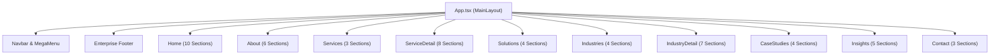

# CYGNUSA Technologies — Design System, Color Palette & Architecture Guide

A comprehensive architectural and design specification for the **CYGNUSA Technologies** enterprise digital platform.

---

## 1. Executive Summary

CYGNUSA Technologies' digital presence is designed around an enterprise-grade, high-trust B2B aesthetic inspired by modern enterprise design systems (Hitachi Vantara, Stripe, Apple). It balances a crisp light-theme foundation with high-contrast cyber and cosmic accents, tactile 3D interactive physics elements, and clear informational hierarchy.

| Key Metric | Value | Details |
| :--- | :--- | :--- |
| **Total Registered Pages** | **13 Pages** | 8 Core Routes + 3 Dynamic Detail Routes + 2 Utility Routes |
| **Total Reusable Section Components** | **16 Sections** | Located in `src/components/sections/` |
| **Total Core Data Models** | **5 Repositories** | Services (9), Solutions (7), Industries (7), Case Studies (10), Insights (7) |
| **Styling Engine** | **Tailwind CSS + Custom CSS Variables** | Fluid container, custom brand tokens, micro-animations |
| **3D & Physics Engines** | **Three.js + Cannon-es** | Interactive 3D Lanyard Badge & Interactive 3D Earth Globe |

---

## 2. Brand Identity & Design System

### 2.1 Design Philosophy
1. **Light-First Enterprise Aesthetic**: Clean `#FFFFFF` base canvas and `#F8FAFC` slate surfaces, establishing clarity, authority, and enterprise trust.
2. **Strategic High-Contrast Accents**: Vibrant `cygnusa-sky` (`#0EA5E9`) for calls to action, active indicators, and cyber glows; `cygnusa-void` (`#0F172A`) for high-contrast typographic hierarchy.
3. **Tactile 3D Micro-Experiences**: Real-time WebGL rendering (Three.js + Cannon physics) for the interactive employee credentials badge and global delivery globe, communicating technical depth.
4. **Strict Accessibility**: Minimum 4.5:1 contrast ratios on all text, explicit focus rings (`:focus-visible`), and semantic HTML throughout.

---

### 2.2 Color System & Design Tokens

Defined in `tailwind.config.ts` and `src/styles/variables.css`:

```css
:root {
  /* Primary & Accents */
  --color-cygnusa-sky: #0EA5E9;       /* Primary buttons, links, active states, key accents */
  --color-cygnusa-sky-hover: #0284C7; /* Interactive hover state */
  --color-cosmic-deep: #0EA5E9;       /* Gradient lines, highlight glows */
  --color-cosmic-dark: #172554;       /* Deep enterprise navy accents */

  /* Neutrals & Surfaces */
  --color-void-black: #0F172A;        /* Primary typography, headers, dark banners */
  --color-silver-mist: #64748B;       /* Secondary body copy, descriptions */
  --color-mist-light: #94A3B8;        /* Captions, subtle metadata, disabled states */
  --color-ether-white: #F8FAFC;       /* Primary background for alternating sections */
  --color-surface-white: #FFFFFF;     /* Card background, header background */
  --color-border-subtle: #E2E8F0;     /* Card outlines, dividers, table borders */

  /* Semantic Feedback */
  --color-abundance-green: #10B981;   /* ISO clearance badges, live pulse, verified status */
}
```

#### Color Token Mapping Matrix

| Token Name | Hex Code | Tailwind Class | Primary Usage |
| :--- | :--- | :--- | :--- |
| **Sky (Brand Primary)** | `#0EA5E9` | `bg-cygnusa-sky`, `text-cygnusa-sky`, `border-cygnusa-sky` | Primary CTAs, active links, glow accents, badge borders |
| **Sky Hover** | `#0284C7` | `hover:bg-cygnusa-sky-hover` | Interactive button and link hover states |
| **Void Black** | `#0F172A` | `text-cygnusa-void`, `bg-slate-900` | Main titles (`h1`-`h3`), high-contrast dark sections |
| **Cosmic Dark** | `#172554` | `bg-cygnusa-cosmic-dark` | Deep navy container backgrounds |
| **Silver Mist** | `#64748B` | `text-cygnusa-mist` | Paragraph body copy, card summaries, subtitles |
| **Mist Light** | `#94A3B8` | `text-slate-400` | Timestamp labels, secondary metadata, breadcrumb separators |
| **Ether Surface** | `#F8FAFC` | `bg-slate-50`, `bg-cygnusa-ether` | Alternating section backgrounds, card gutters |
| **Pure White** | `#FFFFFF` | `bg-white` | Main page background, elevated card panels |
| **Subtle Border** | `#E2E8F0` | `border-cygnusa-border` | Subtle 1px borders on cards, navigation, and dividers |
| **Emerald Green** | `#10B981` | `text-emerald-500`, `bg-emerald-500` | ISO 27001 clearance pills, active status dots |

---

### 2.3 Typography Hierarchy

Font families configured via Google Fonts and Tailwind:

* **Headings**: `'Poppins', sans-serif` (`font-heading`)
  * Character: Geometric, bold, modern enterprise feel.
  * Letter Spacing: `-0.02em` for tight, cohesive headline locking.
* **Body**: `'Inter', system-ui, sans-serif` (`font-sans`)
  * Character: Clean, neutral, high legibility across desktop and mobile screens.
  * Line Height: `leading-relaxed` (1.625) for effortless scanning.
* **Technical & Data**: `'JetBrains Mono', monospace` (`font-mono`)
  * Character: Monospaced precision for Employee IDs (`CYG-002`), ISO standard codes (`ISO/IEC 27001:2022`), and terminal tags.

#### Typographic Scale

| Level | Size | Weight | Line Height | Usage |
| :--- | :--- | :--- | :--- | :--- |
| **Display H1** | `36px` to `56px` | `font-bold` (700) | `leading-tight` | Main Hero Headlines |
| **Page H1** | `30px` to `44px` | `font-bold` (700) | `leading-tight` | Page Headers |
| **Section H2** | `24px` to `36px` | `font-bold` (700) | `leading-snug` | Major Section Titles |
| **Card H3** | `18px` to `22px` | `font-bold` (700) | `leading-normal` | Card Headers & Feature Titles |
| **Subheading H4** | `14px` to `16px` | `font-semibold` (600) | `leading-normal` | Group titles, specialist names |
| **Lead Paragraph** | `16px` to `18px` | `font-normal` (400) | `leading-relaxed` | Hero introductory subheadings |
| **Standard Body** | `14px` (0.875rem) | `font-normal` (400) | `leading-relaxed` | General card text & descriptions |
| **Small / Caption** | `12px` (0.75rem) | `font-medium` (500) | `leading-normal` | Meta pills, tags, category badges |
| **Micro Tag** | `10px` to `11px` | `font-bold` (700) | `leading-none` | Overline uppercase category labels |

---

### 2.4 Elevation & Shadows

```css
boxShadow: {
  'subtle': '0 1px 3px 0 rgba(0, 0, 0, 0.05), 0 1px 2px -1px rgba(0, 0, 0, 0.05)',
  'card': '0 4px 6px -1px rgba(15, 23, 42, 0.04), 0 2px 4px -2px rgba(15, 23, 42, 0.04)',
  'card-hover': '0 10px 15px -3px rgba(15, 23, 42, 0.08), 0 4px 6px -4px rgba(15, 23, 42, 0.04)',
  'mega-menu': '0 20px 25px -5px rgba(15, 23, 42, 0.1), 0 8px 10px -6px rgba(15, 23, 42, 0.05)',
}
```

---

### 2.5 Grid & Layout System

* **Max Width**: `1320px` (`max-w-site` / `.container-custom`).
* **Gutters**: `px-4` on mobile, `px-6` on tablet, `px-8` on desktop.
* **Component Rhythm**: Sections spaced with `py-16 md:py-24` on desktop, `py-12 sm:py-16` on mobile.

---

## 3. Project Pages Inventory (13 Pages)

CYGNUSA Technologies features **13 route-mapped page views**:

| # | Route | Component | Page Type | Primary Purpose |
| :-: | :--- | :--- | :--- | :--- |
| **1** | `/` | `Home.tsx` | Core Landing | Primary entry point showcasing capabilities, client trust, interactive 3D globe, and customer stories. |
| **2** | `/about` | `About.tsx` | Core Brand | Leadership overview, C-Y-G-N-U-S-A values, 3D Lanyard team gallery, and accredited ISO standards. |
| **3** | `/services` | `Services.tsx` | Index | Comprehensive directory of CYGNUSA's 8 core technology service practices. |
| **4** | `/services/:slug` | `ServiceDetail.tsx` | Dynamic Detail | In-depth architectural breakdown, capabilities, tech stack, and case studies for a selected service. |
| **5** | `/solutions` | `Solutions.tsx` | Index | Strategic multi-domain architectural solutions (Cloud, Modernisation, Digital Transformation). |
| **6** | `/industries` | `Industries.tsx` | Index | Enterprise domain solutions across Manufacturing, Energy, Aviation, Retail, and SMBs. |
| **7** | `/industries/:slug`| `IndustryDetail.tsx` | Dynamic Detail | Domain-specific compliance frameworks, challenges, solutions, and relevant customer case studies. |
| **8** | `/case-studies` | `CaseStudies.tsx` | Index | Verified customer success stories with quantitative metrics, architectural challenges, and outcomes. |
| **9** | `/insights` | `Insights.tsx` | Index | Filterable repository of engineering articles, tools & templates, and whitepapers. |
| **10**| `/insights/:slug` | `InsightDetail.tsx` | Dynamic Detail | Dedicated article view with author metadata, key takeaways, diagrams, and related insights. |
| **11**| `/contact` | `Contact.tsx` | Action / Lead Gen | Leadership contact channels (Chennai HQ, IIT Guwahati), working hours, and consultation booking form. |
| **12**| `/privacy-policy` | `PrivacyPolicy.tsx`| Legal / Compliance | Corporate data protection policies aligned with ISO/IEC 27001:2022 standards. |
| **13**| `*` | `NotFound.tsx` | Error Handling | 404 error page with navigational recovery links. |

---

## 4. Reusable Section Components Inventory (16 Sections)

All sections are modular, self-contained, and located in `src/components/sections/`:

| # | Section Component | File Path | Key Features & Implementation |
| :-: | :--- | :--- | :--- |
| **1** | **HeroSection** | `HeroSection.tsx` | High-impact enterprise hero banner, Hitachi Vantara-style floating overlapping white card, dual action CTAs, partner trust badges. |
| **2** | **TrustSection** | `TrustSection.tsx` | Social proof statement, client enterprise partner logos, certified ISO credentials strip. |
| **3** | **ChallengesSolutionsSection** | `ChallengesSolutionsSection.tsx` | "Your challenges drive our solutions" interactive tabbed accordion interface mapping pain points to engineering answers. |
| **4** | **FeaturedReportSection** | `FeaturedReportSection.tsx` | High-contrast dark banner featuring enterprise industry benchmark reports and instant PDF download triggers. |
| **5** | **InsightsSection** | `InsightsSection.tsx` | "This just in" 3-column insights and engineering updates grid with reading time badges and category tags. |
| **6** | **CaseStudiesSection** | `CaseStudiesSection.tsx` | Customer impact showcase featuring floating white narrative cards, quantifiable ROI metrics, and case study links. |
| **7** | **InteractiveGlobeSection** | `InteractiveGlobe3D.tsx` | Interactive 3D Three.js Earth globe rendering global delivery hubs (Chennai HQ, IIT Guwahati, North America, Europe, Middle East). |
| **8** | **GlobalPresenceSection** | `GlobalPresenceSection.tsx` | Regional delivery presence breakdown, office coordinates, and international delivery governance. |
| **9** | **PartnershipStripSection** | `PartnershipStripSection.tsx` | Vibrant high-contrast partnership action strip inviting technology collaboration. |
| **10**| **ResourcesDarkSection** | `ResourcesDarkSection.tsx` | High-density dark resource panel highlighting tools, ROI calculators, templates, and architectural guides. |
| **11**| **TeamLanyardSection** | `TeamLanyardSection.tsx` | **Signature Component**: Features the dedicated Founder & MD showcase, the 3D interactive swinging lanyard badge (Three.js WebGL physics), and 60fps Coverflow carousel. |
| **12**| **AboutSection** | `AboutSection.tsx` | High-level corporate mission and strategic consulting methodology overview. |
| **13**| **ServicesSection** | `ServicesSection.tsx` | Service capability cards with quick-link navigation to detail views. |
| **14**| **SolutionsSection** | `SolutionsSection.tsx` | Architectural solution pillars mapping business challenges to cloud & modernization responses. |
| **15**| **IndustriesSection** | `IndustriesSection.tsx` | Industry verticals overview cards highlighting sector-specific engineering competencies. |
| **16**| **ContactCTASection** | `ContactCTASection.tsx` | Minimal fluid pre-footer CTA ("Ready to give it a try?") prompting consultations with senior partners. |

---

## 5. Page-by-Page Section Architecture Breakdown



### Detailed Breakdown:

#### 1. Home Page (`/`) — 10 Sections
1. `HeroSection` — Floating Overlapping White Card & Primary Hero
2. `TrustSection` — Customer Trust & Enterprise Social Proof
3. `ChallengesSolutionsSection` — Interactive Problem/Solution Accordion
4. `FeaturedReportSection` — High-Impact Dark Research Banner
5. `InsightsSection` — "This just in" Engineering & News Grid
6. `CaseStudiesSection` — Customer Impact Story with Floating White Card
7. `InteractiveGlobeSection` — 3D Real-World Earth Global Delivery Grid
8. `PartnershipStripSection` — Enterprise Partnership Action Strip
9. `ResourcesDarkSection` — Dark Container for Tools, Calculators & Guides
10. `ContactCTASection` — Fluid Pre-Footer Consultation CTA

#### 2. About Page (`/about`) — 6 Sections
1. Hero Header — "Technology Partner. Not Just a Vendor."
2. Mission & Story — Company Narrative + Company Snapshot Card
3. Core Values — C-Y-G-N-U-S-A 7-Principle Grid
4. `TeamLanyardSection` — Dedicated Founder Section + 3D Lanyard Coverflow Gallery + Verified Profile Strip
5. Certifications Section — ISO 27001, ISO 20000-1, ISO 9001, DPIIT #StartupIndia
6. `ContactCTASection` — Consultation Booking CTA

#### 3. Services Page (`/services`) — 3 Sections
1. Hero Header — Capabilities Overview & Tagline
2. Services Directory List — Detailed capability cards for all 8 practice areas
3. `ContactCTASection` — Pre-Footer Consultation CTA

#### 4. Service Detail Page (`/services/:slug`) — 8 Sections
1. Breadcrumbs & Hero Header with Icon & Category Tag
2. Value Proposition & Strategic Delivery Impact
3. Core Architectural Capabilities List with Checkmarks
4. Advise-Build-Run Delivery Methodology Stepper
5. Technology Stack & Enterprise Tooling Matrix
6. ISO 27001 Security & Compliance Guarantee
7. Relevant Customer Case Studies Grid
8. `ContactCTASection` — Pre-Footer Consultation CTA

#### 5. Solutions Page (`/solutions`) — 4 Sections
1. Breadcrumbs Navigation
2. Hero Header — "Unified Technology for Business Growth"
3. Solutions Architectural Cards — Challenge, Solution, Outcomes, Tech Stack for all 7 solutions
4. `ContactCTASection` — Pre-Footer Consultation CTA

#### 6. Industries Page (`/industries`) — 4 Sections
1. Breadcrumbs Navigation
2. Hero Header — Domain Verticals Overview
3. Industry Cards Grid — 6 Sector Cards with Key Focus Areas
4. `ContactCTASection` — Pre-Footer Consultation CTA

#### 7. Industry Detail Page (`/industries/:slug`) — 7 Sections
1. Breadcrumbs & Industry Hero with Domain Badge
2. Domain Challenges & Regulatory Headwinds
3. Architectural Capabilities & Solutions Response
4. Industry Tech Stack & Compliance Highlights
5. Industry-Specific Case Studies
6. Strategic Advisory Consultation Strip
7. `ContactCTASection` — Pre-Footer Consultation CTA

#### 8. Case Studies Page (`/case-studies`) — 4 Sections
1. Breadcrumbs Navigation
2. Hero Header — "Customer Success Stories & Case Studies"
3. Verified Case Study Cards Grid — 10 Case Studies with ROI Metrics & Challenges
4. `ContactCTASection` — Pre-Footer Consultation CTA

#### 9. Insights Page (`/insights`) — 5 Sections
1. Breadcrumbs Navigation
2. Hero Header — "Engineering Insights & Enterprise Perspectives"
3. Category Filter Tabs — 'All', 'Tools & Templates', 'Article', 'Technology Update', 'Case Study'
4. Filtered Insights Grid — 7 Articles & Guides with Reading Time
5. `ContactCTASection` — Pre-Footer Consultation CTA

#### 10. Insight Detail Page (`/insights/:slug`) — 4 Sections
1. Breadcrumbs Navigation
2. Article Header with Category, Author, Date & Reading Time
3. Rich Article Body Content with Takeaway Callouts
4. Related Insights & Topic Recommendations
5. `ContactCTASection` — Pre-Footer Consultation CTA

#### 11. Contact Page (`/contact`) — 3 Sections
1. Breadcrumbs Navigation
2. Hero Header — "Direct Access to Leadership"
3. Contact Grid:
   - Leadership & Office Locations Card (Chennai HQ, IIT Guwahati Campus, Phone, Email, ISO Clearance)
   - Interactive Consultation Form (`ContactForm`) with Service Selectors

#### 12. Privacy Policy Page (`/privacy-policy`) — 2 Sections
1. Breadcrumbs Navigation
2. Comprehensive Legal & Data Protection Policy (ISO 27001 ISMS Standards)

#### 13. Not Found Page (`*`) — 1 Section
1. 404 Error State with Home Navigation Button

---

## 6. Shared Layout & Global Components

1. **Header & Navigation (`src/components/layout/Header.tsx`, `Navbar.tsx`)**:
   * Fixed header at `--header-height: 92px`.
   * Hitachi Vantara-style multi-column **MegaMenu** with hover intent, categories, feature cards, and direct links to Tools & Templates.
   * Responsive **MobileNavigation** slide-over drawer with collapsible category accordions.
2. **Footer (`src/components/layout/Footer.tsx`)**:
   * Corporate registration details (`CIN U72900TN2020PTC135633`).
   * Audited ISO standards & DPIIT #StartupIndia recognition badges.
   * Categorized sitemap links across Services, Solutions, Industries, Company, Legal.
   * Dual office physical addresses (Chennai Global Delivery HQ & IIT Guwahati R&D Center).
3. **Common Reusable Controls (`src/components/common/`)**:
   * `Button.tsx`: Variants (`primary`, `secondary`, `outline`, `ghost`, `link`) and sizes.
   * `Breadcrumbs.tsx`: Schema-compliant breadcrumb trail.
   * `SectionHeading.tsx`: Standardized overline, title, description, and alignment.
   * `BackToTop.tsx`: Floating scroll-to-top button with smooth window scrolling.
   * `ImageWithFallback.tsx`: Resilient image loading with graceful fallback states.
   * `Lanyard.tsx`: Real-time 3D Three.js WebGL physics simulation badge.

---

## 7. Data Repositories Summary

All static data is structured in `src/data/`:

* **`services.ts` (9 Items)**: Virtual CTO Advisory, Managed IT & Cloud Ops, Cybersecurity & ISO Compliance, Enterprise Software Engineering, Applied AI & LLM Systems, Staff Augmentation, Offshore Development Centers, Software & Cloud Reselling, and DevOps/CI-CD.
* **`solutions.ts` (7 Items)**: Cloud & Infrastructure Modernisation, Digital Transformation, Application Modernisation, Enterprise Applications (ERP/CRM), IT as a Service (ITaaS), AI & Intelligent Automation, and Zero Trust Cyber Security.
* **`industries.ts` (7 Items)**: Manufacturing & Automotive, Energy & Utilities, Aviation & Logistics, Retail & E-Commerce, Professional & Financial Services, High-Growth SMBs, and Healthcare Technology.
* **`caseStudies.ts` (10 Items)**: Automotive After-Sales ERP, Licensed Fuel-Tech IoT Platform, Aviation Ground Handling Portal, Enterprise Supply Chain Visibility, Multi-Tenant SaaS Engine, FinOps Cloud Optimization, Zero-Trust Healthcare Migration, etc.
* **`insights.ts` (7 Items)**: Cloud FinOps Frameworks, Enterprise RAG Architecture, ISO 27001 Audit Readiness Checklist, Tools & Templates guides.

---

*Generated for CYGNUSA Technologies — Production Architecture Documentation.*
